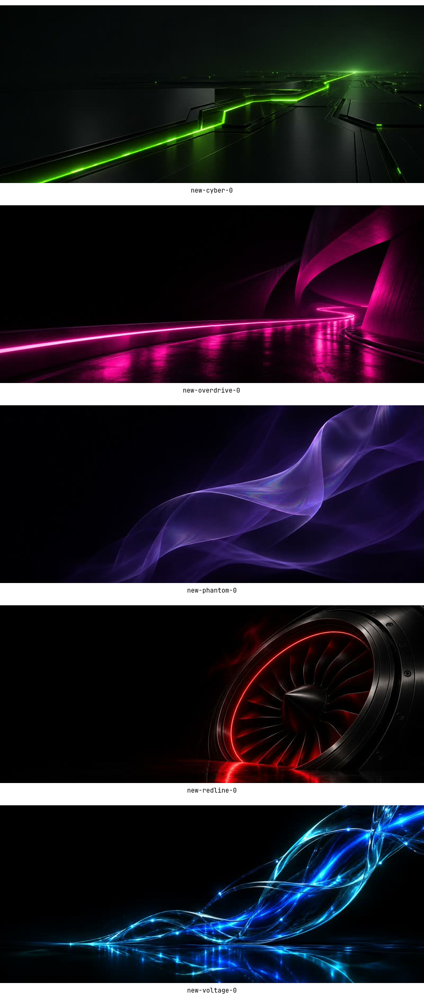
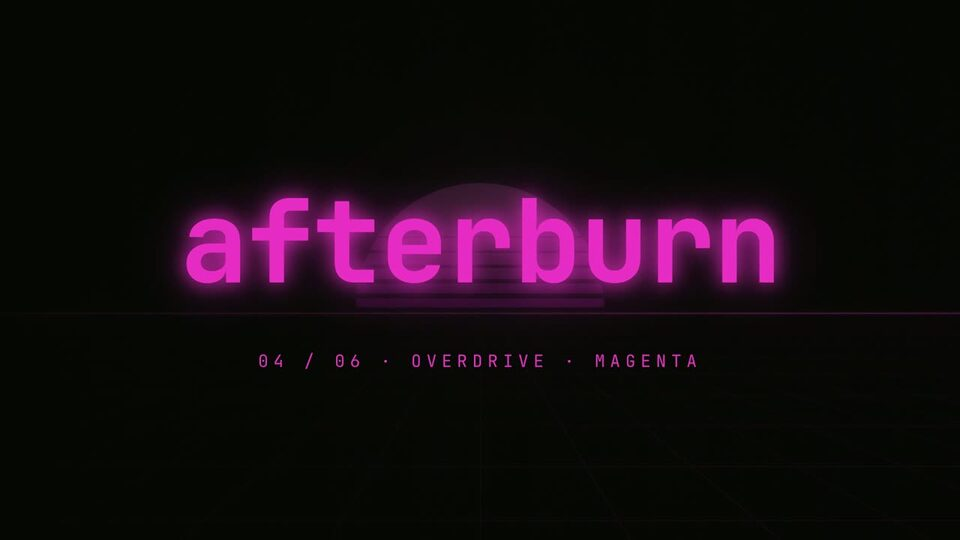
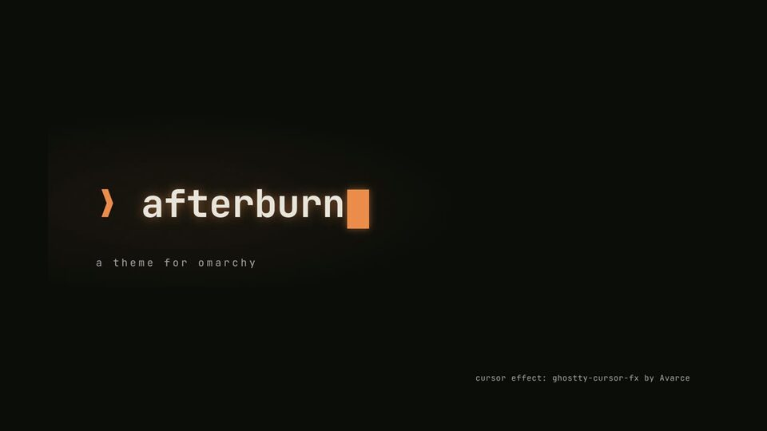
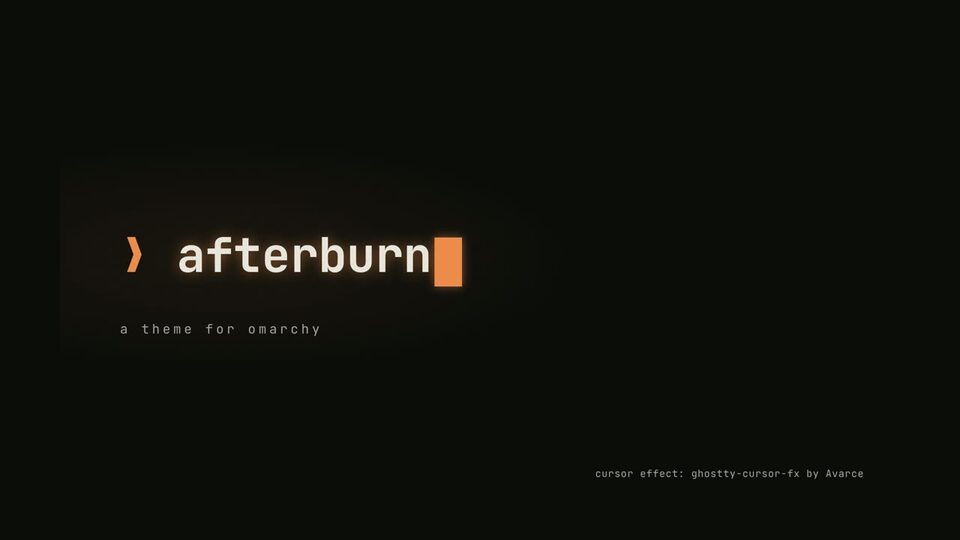

# ❯ afterburn


**Orange-on-black cyber theme for [Omarchy](https://omarchy.org).** Ember-gradient window borders with a soft orange glow, animated ember cursors in Ghostty, and nineteen wallpapers: eleven stills and eight live loops across all six colours. Comes in six colours, each with its own personality: Afterburn (orange), Voltage (cyan), Cyber (green), Overdrive (magenta), Redline (red) and Phantom (violet). See [Editions](#editions).

## Install: the full stack (recommended)

```bash
omarchy theme install https://github.com/silverwulf212/omarchy-afterburn-theme && ~/.config/omarchy/themes/afterburn/extras/install.sh
```

> [!IMPORTANT]
> **This replaces your default terminal with Ghostty** and installs third-party software. See [What the full stack changes](#what-the-full-stack-changes) before you run it.

The second half shows a summary of what it will change, then asks before every optional step. Two things come with the first "Continue?" and are not asked again: the theme-set hook that restores the glow, and a final `omarchy theme set`.

1. **Ghostty**: installs it and makes it your default terminal, if needed
2. **cursor-fx**: animated Ghostty cursors. Afterburn uses *embers*: typing kicks up glowing embers that rise and cool. Each [colour edition](#editions) picks its own effect
3. **Glow**: the orange halo around the focused window
4. **Subtle pack** (optional): a slow-turning border, dimmed background windows, heat levels, quiet fullscreen, battery saver, a red prompt with a fail flash, and the `afterburn` command. See [Subtle pack](#subtle-pack)
5. **Lock screen** (optional, asked separately): embers on the lock screen. See [Lock screen](#lock-screen)
6. **Colour editions** (optional, asked separately): Voltage, Cyber, Overdrive, Redline and Phantom, the same theme in other colours, and Lite, the light one. See [Editions](#editions)
7. **Boot and login screen** (optional, needs `sudo`, default No): sets Omarchy's boot splash and login screen to the current theme. See [Boot and login screen](#boot-and-login-screen)

Add `--yes` to answer yes to every question. Two exceptions: `--yes` never changes your heat source (it is `time` on a first install, so it never turns on the weather source, the only part that calls the network once running), and the boot and login screen is never changed by `--yes` because it needs `sudo`. Re-running the installer is safe: it keeps your settings, including the heat source. Run it once after you update the theme: the theme-set hook is a copy, so a new release's hook (and its edition behaviour) only takes effect after that. To undo, run `~/.config/omarchy/themes/afterburn/extras/uninstall.sh`. Switching to another theme also puts your previous cursor effect back.

## Install: theme only

```bash
omarchy theme install https://github.com/silverwulf212/omarchy-afterburn-theme
```

You get the colors, the ember-gradient borders, the wallpapers and the icons. The glow and the cursors need the extras, because Omarchy doesn't run code from a theme by itself.

## Requirements

- Omarchy 4.x (tested on 4.5.0, Hyprland 0.56).
- Ghostty is optional: the cursor effects need it, and the installer offers to install it.
- bash, for the fail flash (the red-prompt effect after a failed command).

## Undo

```bash
~/.config/omarchy/themes/afterburn/extras/uninstall.sh
```

It removes only what the installer created and puts your previous terminal, font and cursor effect back (unless you changed them since). Your `afterburn.conf` is kept as `afterburn.conf.bak` (`.bak.1`, `.bak.2`, ... if a backup is already there; an earlier backup is never overwritten). The table in [What the full stack changes](#what-the-full-stack-changes) lists the undo for each piece.

## Update

```bash
omarchy theme update
~/.config/omarchy/themes/afterburn/extras/install.sh
```

Run the installer again so the hook and the service copies refresh. Installed edition folders keep their existing files; the installer only adds files they lack.

**Installed before 12 November 2026?** The repository's history was rewritten that day to drop about 85 MiB of replaced wallpapers from every download. For an older install, `omarchy theme update` (a `git pull`) fails or stops with a git error about divergent or unrelated histories, or about not being able to fast-forward. The exact words depend on your git pull settings. With `pull.rebase=true` it may even look like it worked. Run this once either way, then update as above from then on:

```bash
git -C ~/.config/omarchy/themes/afterburn fetch --prune --prune-tags --force origin
git -C ~/.config/omarchy/themes/afterburn reset --hard origin/main
~/.config/omarchy/themes/afterburn/extras/install.sh
```

Your settings in `${XDG_CONFIG_HOME:-~/.config}/afterburn` are kept. The reset replaces only the theme folder's tracked files, so it discards any edits you made inside that folder. The installer run makes the hook and watcher copies match the new files.

To also free the old 85 MiB from that folder, run:

```bash
git -C ~/.config/omarchy/themes/afterburn reflog expire --expire=now --all
git -C ~/.config/omarchy/themes/afterburn gc --prune=now
```

The clean alternative is `omarchy theme install https://github.com/silverwulf212/omarchy-afterburn-theme`. It clones from scratch and switches the active theme to base Afterburn. Then run the installer as above, otherwise the hook and watcher copies stay old.

## New edition wallpapers



Full-resolution **theme backgrounds**, including the animated MP4s:

| Edition | Wallpaper | Still | Animated wallpaper |
|---|---|---|---|
| Afterburn | Horizon | [JPG](backgrounds/1-horizon.jpg) | [MP4](backgrounds/9-horizon-live.mp4) |
| Voltage | Resonance | [JPG](backgrounds/voltage-resonance.jpg) | [MP4](backgrounds/voltage-resonance-live.mp4) |
| Cyber | Phosphor Path | [JPG](backgrounds/cyber-phosphor-path.jpg) | [MP4](backgrounds/cyber-phosphor-path-live.mp4) |
| Overdrive | Midnight Ribbon | [JPG](backgrounds/overdrive-midnight-ribbon.jpg) | [MP4](backgrounds/overdrive-midnight-ribbon-live.mp4) |
| Redline | Crimson Turbine | [JPG](backgrounds/redline-crimson-turbine.jpg) | [MP4](backgrounds/redline-crimson-turbine-live.mp4) |
| Phantom | Spectral Veil | [JPG](backgrounds/phantom-spectral-veil.jpg) | [MP4](backgrounds/phantom-spectral-veil-live.mp4) |

[Browse every background and download the original files](WALLPAPERS.md). All six colours are directly available in [`backgrounds/`](backgrounds/). Each colour edition also keeps its own default and live loop in `.editions/<name>/backgrounds/`.

## Theme-selector previews

All six selector thumbnails show each theme's actual default wallpaper. The
Afterburn wordmark is reserved for boot/login artwork.

For an existing installation, update the checkout and refresh only its selector
images (rerunning the extras installer preserves existing preview files). If you
installed before 12 November 2026, run the one-time fix under Update first; a plain
`git pull --ff-only` fails on the rewritten history.

```bash
cd ~/.config/omarchy/themes/afterburn
git pull --ff-only
python3 tools/wallpapers/selector-previews.py install
```

This generates thumbnails from each installed theme's own `backgrounds/1-horizon.jpg`,
backs up changed `preview.png` files under `~/.local/state/afterburn/preview-backups/`,
and preserves custom preview symlinks. Close and reopen the theme selector afterward.
To undo, restore the saved `preview.png` files from the printed backup folder.

## Watch

| [](https://github.com/SilverWulf212/omarchy-afterburn-theme/releases/download/v1.0.0/editions.mp4) | [](https://github.com/SilverWulf212/omarchy-afterburn-theme/releases/download/v1.0.0/brag-v2.mp4) | [](https://github.com/SilverWulf212/omarchy-afterburn-theme/releases/download/v1.0.0/brag.mp4) |
|---|---|---|
| **Six editions** (57 s) | **Launch v2** (69 s) | **Original launch** (39 s) |

Click a thumbnail to play or download the video from the [v1.0.0 release](https://github.com/SilverWulf212/omarchy-afterburn-theme/releases/tag/v1.0.0). Music: Sascha Ende, ende.app, CC BY 4.0.

## What the full stack changes

> [!WARNING]
> **The full-stack installer replaces your default terminal with Ghostty** and installs third-party code. It lists everything below and asks before every optional step. Read this section before you say yes.

| Change | Details | How to undo |
|---|---|---|
| **Default terminal** | Installs Ghostty with pacman (needs `sudo`) and/or makes it your default terminal. Super + Return, "open in terminal" and Omarchy's TUIs all open in Ghostty instead of your current terminal. | `uninstall.sh` restores the previous default. |
| **Font** | Sets your system font (terminals, bar, menus) to JetBrainsMono Nerd Font, Omarchy's default, if you've changed it. | `uninstall.sh` restores your previous font. |
| **Third-party code** | Clones [ghostty-cursor-fx](https://github.com/Avarce/ghostty-cursor-fx) by Avarce (MIT), pinned to commit `252df6c`, and runs its `install.sh`. Read that repo before you trust it, as with any script from the internet. | See the commands that `uninstall.sh` prints. |
| **Ghostty config** | cursor-fx writes `~/.config/ghostty/shaders/`, `~/.config/ghostty/cursor-effects/` and `~/.local/bin/cursor-fx`, and adds a `config-file = cursor-effects/…` line to `~/.config/ghostty/config`. It backs up anything it replaces to `~/ghostty-savepoints/`. | Restore from `~/ghostty-savepoints/`, or `cursor-fx off`. |
| **pi agent** (only if `~/.pi/agent` exists) | cursor-fx adds a pi extension and sets `showHardwareCursor: true` in pi's settings. | Delete `~/.pi/agent/extensions/cursor-fx.ts`. |
| **Omarchy hook** | Adds `~/.config/omarchy/hooks/theme-set.d/50-afterburn-extras`. It runs on **every** theme change: on Afterburn or one of its colour editions it adds the glow in that theme's colours, sets the theme's cursor effect (embers on base, the edition's own on an edition), recolours the lock-screen embers and gives them the edition's motion, applies the subtle pack's settings and restarts the watcher. On other themes it stops the watcher, restores your previous cursor effect and puts the lock embers back to orange and rising. | `uninstall.sh` |
| **Subtle pack** | Links `afterburn` and `afterburn-watch` into `~/.local/bin`, writes `~/.config/afterburn/afterburn.conf`, and copies the "Afterburn colors" launcher entry to `~/.local/share/applications/`. | `uninstall.sh` removes the links and the launcher entry, and keeps the conf as `afterburn.conf.bak` (or the next free `.bak.N`). |
| **Watcher service** | Installs and starts a user systemd service, `afterburn-watch`, that handles fullscreen, battery and heat changes. | `uninstall.sh` disables and removes it. |
| **Network calls** | Only if you choose the weather heat source: `api.weather.gov` (station and observations, at most every 20 minutes) and `api.zippopotam.us` (one ZIP lookup when you enter your ZIP). No other option makes a network call. | Choose another `HEAT_SOURCE`, or run `uninstall.sh`. |
| **Shell and prompt** | Adds one guarded line to `~/.bashrc` that sources the fail flash, and sets `error_symbol` in `~/.config/starship.toml` so a failed command shows a red `❯`. Only the original `error_symbol` line is remembered, and a whole-file copy is kept in `~/.local/state/afterburn/` as a safety copy. If you have no starship.toml, the prompt is left alone. | `uninstall.sh` removes the line and puts the original `error_symbol` back, only if that line is still Afterburn's. Other edits to your starship.toml are kept. |
| **Lock screen** (asked separately) | Clones Omarchy's lock plugin with its official clone command (as `~/.config/omarchy/plugins/afterburn.lock`) and adds an ember layer to the clone. The clone does not get Omarchy's lock-screen updates until you uninstall. If a step fails, the built-in lock is switched back on. | `uninstall.sh` runs `lock-embers.sh uninstall`. |
| **Colour editions** (asked separately) | Copies each `.editions/<name>/` folder of the installed theme to `~/.config/omarchy/themes/afterburn-<name>`. A folder that is already there is **never** overwritten, and the installer records only what it created. On a re-run, a folder it created gets only the files it lacks (a newer release's wallpapers, say); nothing existing is changed. If `.editions/` is missing, the step is skipped. | `uninstall.sh` removes only the folders the installer created. If one is your active theme, it switches you to base `afterburn` first. |
| **Boot and login screen** (asked separately, default No) | Runs Omarchy's `omarchy-plymouth-set-by-theme <theme>` for the current theme, which changes the boot splash and the login screen. **Needs `sudo`.** `--yes` skips it. The installer records that it did this. | `omarchy-plymouth-reset` (needs `sudo`), which `uninstall.sh` offers to run, or prints the command if it gets no answer. |
| **State files** | `~/.local/state/afterburn/` (your previous terminal and cursor effect, the starship backup, the colours the fail flash uses, and markers for the lock screen, bashrc, editions and boot screen) and `~/.local/share/afterburn/` (the cursor-fx checkout). | `uninstall.sh` |

**Also worth knowing:**
- **GPU and battery:** while a cursor effect is on, Ghostty redraws constantly, so expect a little extra GPU use and battery drain on laptops. `cursor-fx off` turns it off.
- **Motion and flashing:** the cursor effects animate, and some flash. If you're sensitive to motion or flashing light, skip cursor-fx or run `cursor-fx subtle on`.
- **Uninstall doesn't remove Ghostty or cursor-fx.** It puts back your terminal and cursor settings, and prints the commands to remove the rest.
- **Uninstall removes only what the installer created.** That covers the files in `~/.config/afterburn/` and `~/.local/share/afterburn/` (the folders go too, but only when empty; your `afterburn.conf` is kept as `afterburn.conf.bak` or the next free `.bak.N`, so that folder stays) and the edition folders it copied. An `afterburn-<name>` folder you made yourself is never touched. If an edition is your active theme, `uninstall.sh` switches you to base `afterburn` first. If it can't, it keeps that folder and tells you to switch theme and delete it.
- **The boot and login screen is not undone silently.** If you said yes to it, `uninstall.sh` asks before running `omarchy-plymouth-reset` (needs `sudo`), and prints that command if it gets no answer.
- **No warranty.** This is a personal hobby project, provided as is under the MIT licence. The installer changes your dotfiles, so commit or back them up first if you keep them in git.
- **Not affiliated** with Omarchy, Basecamp, Ghostty, Termix or Avarce. Their names are used here only to give credit and to say what this works with.

## Subtle pack

Optional, part of the full-stack install (step 4). Every setting lives in `~/.config/afterburn/afterburn.conf` as `KEY=VALUE`. `afterburn set KEY VALUE` saves a change and re-applies it. Five of them (`ROTATE`, `DIM`, `GLOW_RANGE`, `CURSOR_FX`, `EMBER_STYLE`) also have a default per [edition](#editions): a value you save here always wins, otherwise the active edition's default applies, otherwise the built-in one in the table. `afterburn unset KEY` drops your value and hands the setting back to the edition. `afterburn get [KEY]` prints a setting, and `afterburn status` shows the heat level, quiet and saver state, and cursor effect.

| Feature | Config key (default) | What it does | Command |
|---|---|---|---|
| Slow-turning border | `ROTATE` (`slow`) | The ember gradient turns around the focused window: `off`, `slow` (10 s per turn), `medium` (5 s) or `fast` (2.5 s). | `afterburn set ROTATE medium` |
| Dimmed background windows | `DIM` (`0.08`) | Dims unfocused windows by this amount. `0` turns it off. | `afterburn set DIM 0.15` |
| Glow range | `GLOW_RANGE` (`14`) | The glow's size at the normal heat level, 4 to 30. Cool and hot keep their ratio to it (8:14 and 22:14). | `afterburn set GLOW_RANGE 20` |
| Cursor effect | `CURSOR_FX` (`embers`) | The cursor-fx effect for the theme: `cyber lightning glitch neon phosphor embers shockwave katana teleport fireworks aurora mecha hologram`. Applied at once by `afterburn set`, and at every theme change. | `afterburn set CURSOR_FX neon` |
| Lock-screen embers | `EMBER_STYLE` (`rise`) | The motion of the lock-screen embers: `rise`, `fall`, `drift`, `spark`, `pulse` or `burst`. See [Lock screen](#lock-screen). Needs the lock-screen step. | `afterburn set EMBER_STYLE fall` |
| Heat levels | `HEAT_WALLPAPERS` (`yes`) | `cool`, `normal` and `hot` change the border colour and glow. With `HEAT_WALLPAPERS=yes` a still wallpaper also swaps to its cool or hot version, from the active theme's own set (orange on Afterburn, the edition's colours on an edition). | `afterburn level hot` |
| Heat source: time | `HEAT_SOURCE=time`, `EVENING_HOURS` (`19-07`) | Cool inside the evening window, normal outside it. | `afterburn set EVENING_HOURS 20-06` |
| Heat source: CPU load | `HEAT_SOURCE=pressure` | Reads CPU pressure (`/proc/pressure/cpu`, 10-second average): cool below 5, hot above 35. | `afterburn set HEAT_SOURCE pressure` |
| Heat source: weather | `HEAT_SOURCE=weather`, `ZIP`, `HOT_F` (`90`), `COOL_F` (`50`) | Reads the nearest National Weather Service station (`api.weather.gov`), at most every 20 minutes. Hot at or above `HOT_F`, cool at or below `COOL_F`, cool in rain, snow or storms, and one level cooler at night. US only. | `afterburn locate 10001`, then `afterburn set HEAT_SOURCE weather` |
| Quiet fullscreen | `FULLSCREEN_QUIET` (`yes`) | In fullscreen: no shadow, no spin, cursor effect off. Restored when you leave fullscreen. | `afterburn quiet on` / `off` |
| Laptop saver | `LAPTOP_MODE` (`auto`) | On battery: no shadow, no spin, and a subtle cursor effect. `auto` follows the power source and only counts the machine's own battery: the battery of a wireless mouse or keyboard (`scope` = `Device` in `/sys/class/power_supply`) is ignored, so a desktop is never in saver mode. `on` and `off` force it. | `afterburn laptop auto` |
| Red prompt and fail flash | `FAIL_FX` (`random`) | A failed command gets a red `❯` in Starship and, in bash, a short flash (zsh and fish get the red prompt only): `burn`, `cascade` or `dissolve`. `random` picks one. Interrupted commands (Ctrl-C, Ctrl-Z) don't flash. Set `NO_MOTION` in your shell to turn the flash off. | `afterburn set FAIL_FX off` |
| Colours | none | Afterburn's named colours. In a terminal, `afterburn colors` shows swatches and copies the one you pick. The "Afterburn colors" launcher entry opens the menu and copies the hex. | `afterburn colors` |

Other commands: `afterburn apply` (rebuilds the glow from the conf and reloads Hyprland), `afterburn level cool|normal|hot`, `afterburn saver on|off`. If the effects look off, run `afterburn status` (it says why quiet or saver is on) or `afterburn doctor` (read-only: power supplies and whether each counts, the watcher, cursor-fx, Ghostty, Hyprland config errors). Battery or laptop mode turns `cursor-fx subtle` back off when it ends, but only if the saver was what turned it on (a subtle you had on yourself stays on; it is also restored when you leave Afterburn or run `uninstall.sh`). The watcher runs as a user service. Check it with `systemctl --user status afterburn-watch`.

## Lock screen

The installer asks this separately (step 5). It runs `extras/lock/lock-embers.sh install`, which clones Omarchy's built-in lock plugin with its official clone command and adds an ember layer to the clone. Omarchy's own lock screen is not edited. The clone is always named `afterburn.lock`, whatever your username is (an older install made as `<username>.lock` is still found and removed by `uninstall.sh`). If anything fails after Omarchy's lock was switched off, the script removes the half-made clone and enables `omarchy.lock` again, so you are never left without a lock screen. If you ever are, run `omarchy plugin enable omarchy.lock`.

The embers follow the active theme: orange on Afterburn, and the edition's own colours on Voltage, Cyber, Overdrive, Redline and Phantom. Each edition also moves them differently (`EMBER_STYLE`, picked from the edition's `edition.conf` or from `afterburn.conf`). The theme-set hook rewrites the colours and the motion in the clone's copy of the ember layer on each theme change, and puts the orange, rising embers back on any other theme.

| Style | Motion | Edition |
|---|---|---|
| `rise` | Embers drift up and cool, about 110 alive. The original | Afterburn |
| `spark` | About 30 short streaks a second fired up in a fan, with a hard flicker | Voltage |
| `fall` | Slow rain from the top edge, a few pixels of wander, glyph-like blinks | Cyber |
| `pulse` | A 110 BPM beat: the glow swells and a row of embers is let go on every beat | Overdrive |
| `burst` | Stillness, then every 2 to 5 s a burst of 8 to 15 sparks that arc up and fall, and a flash | Redline |
| `drift` | About 70 wisps that sway sideways while they rise, fading in and out | Phantom |

No style has more particles than the original (the caps are 150, 120, 120, 100, 80 and 40). `burst` and `spark` are the lightest.

Because it is a clone, the lock screen **stops getting Omarchy's lock-screen updates** until you uninstall. To remove it, run `uninstall.sh` (or `extras/lock/lock-embers.sh uninstall`).

## Editions

The same theme in five more colours plus one light edition, and each has a personality that shows mostly in how things move: the border turn, the glow, the cursor and the lock-screen embers. Each edition is a complete Omarchy theme with its own colours, wallpapers, icons and boot image. They live in the hidden folder `.editions/` of the repo (Omarchy skips dot folders when it stages a theme, so switching to the base theme does not copy them). See [`.editions/README.md`](.editions/README.md) for previews and the exact numbers.

| Edition (theme name) | Colour | Personality | Feeling | Tagline | Cursor | Lock embers | Border |
|---|---|---|---|---|---|---|---|
| Afterburn (`afterburn`) | orange | The original: warm, confident, jet at full burn | heat, momentum | Orange on black. The original burn. | `embers` | `rise` | slow turn, steady glow |
| Voltage (`afterburn-voltage`) | cyan | Restless, clever, always a little charged | alert, crackling | Live wire on black glass. | `lightning` | `spark` | fast turn |
| Cyber (`afterburn-cyber`) | green | 3 AM hacker, quiet control | focus, flow, old-terminal comfort | Acid green. The grid is listening. | `cyber` (data rain) | `fall` | slow turn, soft glow |
| Overdrive (`afterburn-overdrive`) | magenta | Showoff on a neon highway at night | fun, speed, nostalgia | Midnight highway. Magenta past the limiter. | `neon` | `pulse` | medium turn, big bloom |
| Redline (`afterburn-redline`) | red | Dangerous, disciplined, engine at the limit | tension, adrenaline | Blood red at the limiter. Hold it. | `katana` | `burst` | still, tight glow |
| Phantom (`afterburn-phantom`) | violet | The quiet one, barely there | calm, mystery, stealth | Here, then gone. | `hologram` | `drift` | still, wide soft haze, dim backgrounds |
| Lite (`afterburn-lite`) | burnt orange on warm paper (light) | Calm, exact, daylight-clear: ink instead of glow | clarity, warm paper | The same fire, printed on paper. | `embers` (drawn as ink) | `drift` | still, short warm shadow, almost no dimming |

**What only each edition has** (beyond the colours, the heat wallpapers and the lock-screen colours):

- **Voltage:** the lightning cursor; the live wallpaper `live-resonance` (charged blue/cyan glass threads with a slow electrical ripple); crackling spark embers on the lock screen; a btop theme whose meters ramp teal, cyan, white-hot.
- **Cyber:** the data-rain `cyber` cursor (glyph rain, every typed character burns in green); the live wallpaper `live-phosphor-path` (acid-green circuitry with slow optical drift and phosphor light); slow falling rain on the lock screen; a phosphor btop theme and an acid-green Neovim palette.
- **Overdrive:** the neon-tube cursor; the live wallpaper `live-midnight-ribbon` (a magenta highway with gently moving reflections); lock-screen embers that swell on a beat; a hot-pink Neovim palette.
- **Redline:** the katana-slash cursor; the live wallpaper `live-crimson-turbine` (black titanium, a crimson ring and restrained heat shimmer); sudden sparks and stillness on the lock screen; btop meters that run brown, red, white-hot.
- **Lite:** the light one, for daylight and bright rooms. A hand-made palette on warm paper `#f5efe4` where body text, the accent and the ANSI colours (with their bright variants) are at least 4.5:1 against it, muted and secondary text is deliberately fainter at about 3:1 and `orange` is 3.75:1; the base stills reprinted as ink on that paper; two wallpapers of its own, `1-horizon` (an engraved contrail) and `8-heat-shield` (ceramic tiles with heat in the seams); the live wallpaper `live-heat-shield` (the seams glow, shimmer and settle); a short warm shadow instead of a glow, and a hot heat level that deepens the ink instead of whitening it. Its art stays out of the shared `backgrounds/` folder, where a bright wallpaper would jar.
- **Phantom:** the hologram cursor; the live wallpaper `live-spectral-veil` (translucent violet folds with a slow flowing ripple); wisps that fade in and out on the lock screen; the heaviest dimming of background windows.

The installer's edition question (step 6) copies them next to the base theme. Switch with the Omarchy theme menu or `omarchy theme set afterburn-voltage`. `omarchy theme install` alone installs only the base theme: the editions sit in its hidden `.editions/` folder as plain theme directories, so without the installer, copy one to `~/.config/omarchy/themes/afterburn-<name>` yourself (you get its colours, wallpapers, icons, btop and Neovim themes, and its own gradient border and shadow from its `hyprland.lua`, because Omarchy drops `.lua` files only for git-cloned themes; the heat levels, border turn, cursor effect and lock embers still need the extras).

With the extras installed, **every** edition gets the same treatment as base Afterburn, in its own colours: the glow and the border turn, the heat levels, the red-prompt fail flash, `afterburn colors`, the lock-screen embers and the watcher. The colours are read from the active theme's `colors.toml` on every theme change (the cool level's middle stop comes from the `afterburn_cool` key each edition carries). The heat wallpapers follow the edition too: every edition has its own cool and hot set in `heat-wallpapers/`, so `afterburn level hot` swaps a still for its hot version in the edition's colours. A copy of an edition without that folder keeps its wallpaper. The extra live loops are not stills, so heat levels leave them as they are. The border turn, background dimming and glow range are applied by the `afterburn` command, so they need the subtle pack; the cursor effect and the lock-screen embers need only the hook (and, for the embers, the lock-screen step).

### `edition.conf`

Each edition folder carries an `edition.conf` of plain `KEY=VALUE` lines: `CURSOR_FX`, `ROTATE`, `DIM`, `GLOW_RANGE`, `EMBER_STYLE` (what the theme-set hook and the `afterburn` command use) and `TAGLINE`, `PERSONALITY`, `FEELING` (text for the READMEs). It is read as data, never executed, and every value is checked: an unknown cursor name, a `ROTATE` that is not `off|slow|medium|fast`, a `GLOW_RANGE` outside 4 to 30 and so on is ignored, and the next source applies. The order is: a value you saved in `~/.config/afterburn/afterburn.conf` (`afterburn set`), then the edition's `edition.conf`, then the built-in default. `afterburn status` shows which one each setting came from. The edition sources are in `tools/edition-extras/<name>/`; `tools/make-editions.sh` copies them into `.editions/` with the extra wallpapers, btop and Neovim themes, and stops with a message if an `edition.conf` is invalid. Re-running `extras/install.sh` adds the new files (wallpapers, `edition.conf`) to editions it installed earlier, and never overwrites a file that is already there, so a hand-edited installed `edition.conf` stays yours. An edition installed by an older release, with no `edition.conf` of its own, still gets its defaults from the base theme's `.editions/` copy.

## Boot and login screen

Optional, step 7 of the installer, off unless you say yes (`--yes` never does it). It runs `omarchy-plymouth-set-by-theme <theme>` for the current theme, which uses that theme's `unlock.png`, background and foreground colours for Omarchy's boot splash and login screen. It needs `sudo` and changes system files outside your home folder, so the installer says so before it asks. To undo it, run `omarchy-plymouth-reset` (also needs `sudo`). `uninstall.sh` offers to run that for you if the installer did the change, and prints the exact command if it gets no answer.

## Palette

The base theme's palette. Editions swap the orange for their own colour.

| | |
|---|---|
| Accent | `#f59145` |
| Background | `#0c0d0b` |
| Foreground | `#e8e4dc` |
| Ember | `#ff5a1f` |
| Font | JetBrains Mono |

## Wallpapers

Eleven still wallpapers at 3440×1440, plus eight live loops, all directly in `backgrounds/`. The original six orange stills and three orange loops are joined by one signature still and loop per colour edition. Press **Super + Ctrl + Space** to open Omarchy's background switcher and pick one, or run `omarchy theme bg next` to step to the next.

| | | |
|---|---|---|
| `1-horizon`: grid and ember sun | `2-prompt`: glowing prompt | `3-circuit`: circuit traces |
| `4-nozzle`: afterburner nozzle | `5-flow`: light trails over a night city | `6-ember`: macro shot of a glowing ember |
| `7-nozzle-live` (live) | `8-ember-live` (live) | `9-horizon-live` (live) |

**Live loops** (`backgrounds/7-nozzle-live.mp4`, `8-ember-live.mp4`, `9-horizon-live.mp4`) play natively through Omarchy's OWE wallpaper engine, so they need no install step. They pause in fullscreen and follow OWE's battery policy. Heat levels change the borders and glow but keep the live loops as they are. Each [colour edition](#editions) has one bespoke 12 s live loop, named `live-*`, and a matching default still. The three base live loops stay exclusive to orange Afterburn. See [the artwork guide](docs/wallpapers/README.md) for the images, motion, full generation prompts, rebuild commands and installed-theme update instructions. The name sorts after the stills in every locale (a `10-` name would sort first in en_US, because Omarchy picks the first file of a theme), so a theme still opens on its still wallpaper, which is what the heat levels swap.

**Memory:** still wallpapers cost nothing extra. A playing live loop costs about 350 MB of RAM and about 500 MB of video memory, in Omarchy's own renderer (`owe-render`); the figure is the same for every loop, and it is freed about two minutes after you switch back to a still. The watcher service (`afterburn-watch`) uses about 7 MB.

**Heat variants:** 12 in total, six cool and six hot, in `extras/heat-wallpapers/cool/` and `extras/heat-wallpapers/hot/`. Each has the same file name as its still. With `HEAT_WALLPAPERS=yes`, `afterburn level cool` or `hot` swaps a still wallpaper for its variant, and `afterburn level normal` swaps it back. Each colour edition has its own 12 in `.editions/<name>/heat-wallpapers/`, made from these by `tools/make-editions.sh`.

`4`–`6` are AI-generated images (made with OpenAI's image model through Codex, then upscaled). `1`–`3` are generated in code. To re-render them, or change the text on `prompt`:

```bash
uv run --with numpy --with pillow python extras/wallpaper-gen.py backgrounds
```

## Credits

- Animated cursors: **[ghostty-cursor-fx](https://github.com/Avarce/ghostty-cursor-fx)** by Avarce (MIT). Go star it.
- Palette inspired by the default dark UI of [Termix](https://github.com/LukeGus/Termix).
- Built for [Omarchy](https://omarchy.org) by DHH and contributors.

MIT © 2026 SilverWulf
