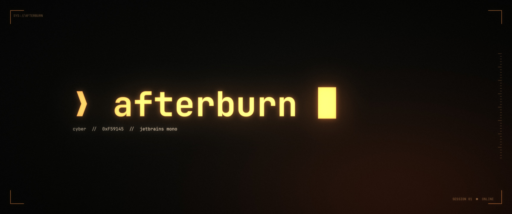

# ❯ afterburn



**Orange-on-black cyber theme for [Omarchy](https://omarchy.org).** Ember-gradient window borders with a soft orange glow, animated ember cursors in Ghostty, and nine wallpapers: six stills and three live loops.

## Install: the full stack (recommended)

```bash
omarchy theme install https://github.com/silverwulf212/omarchy-afterburn-theme && ~/.config/omarchy/themes/afterburn/extras/install.sh
```

> [!IMPORTANT]
> **This replaces your default terminal with Ghostty** and installs third-party software. See [What the full stack changes](#what-the-full-stack-changes) before you run it.

The second half shows a summary of what it will change, then asks before each step:

1. **Ghostty**: installs it and makes it your default terminal, if needed
2. **cursor-fx**: animated Ghostty cursors. Afterburn uses *embers*: typing kicks up glowing embers that rise and cool
3. **Glow**: the orange halo around the focused window
4. **Subtle pack** (optional): a slow-turning border, dimmed background windows, heat levels, quiet fullscreen, battery saver, a red prompt with a fail flash, and the `afterburn` command. See [Subtle pack](#subtle-pack)
5. **Lock screen** (optional, asked separately): embers on the lock screen. See [Lock screen](#lock-screen)

Add `--yes` to answer yes to every question. The exception is the heat source, which becomes `time`, so `--yes` never makes a network call. To undo, run `~/.config/omarchy/themes/afterburn/extras/uninstall.sh`. Switching to another theme also puts your previous cursor effect back.

## Install: theme only

```bash
omarchy theme install https://github.com/silverwulf212/omarchy-afterburn-theme
```

You get the colors, the ember-gradient borders, the wallpapers and the icons. The glow and the cursors need the extras, because Omarchy doesn't run code from a theme by itself.

## What the full stack changes

> [!WARNING]
> **The full-stack installer replaces your default terminal with Ghostty** and installs third-party code. It lists everything below and asks before each step. Read this section before you say yes.

| Change | Details | How to undo |
|---|---|---|
| **Default terminal** | Installs Ghostty with pacman (needs `sudo`) and/or makes it your default terminal. Super + Return, "open in terminal" and Omarchy's TUIs all open in Ghostty instead of your current terminal. | `uninstall.sh` restores the previous default. |
| **Font** | Sets your system font (terminals, bar, menus) to JetBrainsMono Nerd Font, Omarchy's default, if you've changed it. | `uninstall.sh` restores your previous font. |
| **Third-party code** | Clones [ghostty-cursor-fx](https://github.com/Avarce/ghostty-cursor-fx) by Avarce (MIT), pinned to commit `252df6c`, and runs its `install.sh`. Read that repo before you trust it, as with any script from the internet. | See the commands that `uninstall.sh` prints. |
| **Ghostty config** | cursor-fx writes `~/.config/ghostty/shaders/`, `~/.config/ghostty/cursor-effects/` and `~/.local/bin/cursor-fx`, and adds a `config-file = cursor-effects/…` line to `~/.config/ghostty/config`. It backs up anything it replaces to `~/ghostty-savepoints/`. | Restore from `~/ghostty-savepoints/`, or `cursor-fx off`. |
| **pi agent** (only if `~/.pi/agent` exists) | cursor-fx adds a pi extension and sets `showHardwareCursor: true` in pi's settings. | Delete `~/.pi/agent/extensions/cursor-fx.ts`. |
| **Omarchy hook** | Adds `~/.config/omarchy/hooks/theme-set.d/50-afterburn-extras`. It runs on **every** theme change: on Afterburn it adds the glow, sets the embers cursor, applies the subtle pack's settings and restarts the watcher. On other themes it stops the watcher and restores your previous cursor effect. | `uninstall.sh` |
| **Subtle pack** | Links `afterburn` and `afterburn-watch` into `~/.local/bin`, writes `~/.config/afterburn/afterburn.conf`, and copies the "Afterburn colors" launcher entry to `~/.local/share/applications/`. | `uninstall.sh` removes the links, the conf file and the launcher entry. |
| **Watcher service** | Installs and starts a user systemd service, `afterburn-watch`, that handles fullscreen, battery and heat changes. | `uninstall.sh` disables and removes it. |
| **Network calls** | Only if you choose the weather heat source: `api.weather.gov` (station and observations, at most every 20 minutes) and `api.zippopotam.us` (one ZIP lookup when you enter your ZIP). No other option makes a network call. | Choose another `HEAT_SOURCE`, or run `uninstall.sh`. |
| **Shell and prompt** | Adds one guarded line to `~/.bashrc` that sources the fail flash, and sets `error_symbol` in `~/.config/starship.toml` so a failed command shows a red `❯`. Your original starship file is backed up to `~/.local/state/afterburn/`. If you have no starship.toml, the prompt is left alone. | `uninstall.sh` removes the line and restores the backup. |
| **Lock screen** (asked separately) | Clones Omarchy's lock plugin with its official clone command and adds an ember layer to the clone. The clone does not get Omarchy's lock-screen updates until you uninstall. | `uninstall.sh` runs `lock-embers.sh uninstall`. |
| **State files** | `~/.local/state/afterburn/` (your previous terminal and cursor effect, the starship backup, and markers for the lock screen and bashrc) and `~/.local/share/afterburn/` (the cursor-fx checkout). | `uninstall.sh` |

**Also worth knowing:**
- **GPU and battery:** while a cursor effect is on, Ghostty redraws constantly, so expect a little extra GPU use and battery drain on laptops. `cursor-fx off` turns it off.
- **Motion and flashing:** the cursor effects animate, and some flash. If you're sensitive to motion or flashing light, skip cursor-fx or run `cursor-fx subtle on`.
- **Uninstall doesn't remove Ghostty or cursor-fx.** It puts back your terminal and cursor settings, and prints the commands to remove the rest.
- **No warranty.** This is a personal hobby project, provided as is under the MIT licence. The installer changes your dotfiles, so commit or back them up first if you keep them in git.
- **Not affiliated** with Omarchy, Basecamp, Ghostty, Termix or Avarce. Their names are used here only to give credit and to say what this works with.

## Subtle pack

Optional, part of the full-stack install (step 4). Every setting lives in `~/.config/afterburn/afterburn.conf` as `KEY=VALUE`. `afterburn set KEY VALUE` saves a change and re-applies it. `afterburn get [KEY]` prints a setting, and `afterburn status` shows the heat level, quiet and saver state, and cursor effect.

| Feature | Config key (default) | What it does | Command |
|---|---|---|---|
| Slow-turning border | `ROTATE` (`slow`) | The ember gradient turns around the focused window: `off`, `slow` (60 s per turn), `medium` (20 s) or `fast` (8 s). | `afterburn set ROTATE medium` |
| Dimmed background windows | `DIM` (`0.08`) | Dims unfocused windows by this amount. `0` turns it off. | `afterburn set DIM 0.15` |
| Heat levels | `HEAT_WALLPAPERS` (`yes`) | `cool`, `normal` and `hot` change the border colour and glow. With `HEAT_WALLPAPERS=yes` a still wallpaper also swaps to its cool or hot version. | `afterburn level hot` |
| Heat source: time | `HEAT_SOURCE=time`, `EVENING_HOURS` (`19-07`) | Cool inside the evening window, normal outside it. | `afterburn set EVENING_HOURS 20-06` |
| Heat source: CPU load | `HEAT_SOURCE=pressure` | Reads CPU pressure (`/proc/pressure/cpu`, 10-second average): cool below 5, hot above 35. | `afterburn set HEAT_SOURCE pressure` |
| Heat source: weather | `HEAT_SOURCE=weather`, `ZIP`, `HOT_F` (`90`), `COOL_F` (`50`) | Reads the nearest National Weather Service station (`api.weather.gov`), at most every 20 minutes. Hot at or above `HOT_F`, cool at or below `COOL_F`, cool in rain, snow or storms, and one level cooler at night. US only. | `afterburn locate 10001`, then `afterburn set HEAT_SOURCE weather` |
| Quiet fullscreen | `FULLSCREEN_QUIET` (`yes`) | In fullscreen: no shadow, no spin, cursor effect off. Restored when you leave fullscreen. | `afterburn quiet on` / `off` |
| Laptop saver | `LAPTOP_MODE` (`auto`) | On battery: no shadow, no spin, and a subtle cursor effect. `auto` follows the power source. `on` and `off` force it. | `afterburn laptop auto` |
| Red prompt and fail flash | `FAIL_FX` (`random`) | A failed command gets a red `❯` in Starship and a short flash: `burn`, `cascade` or `dissolve`. `random` picks one. Interrupted commands (Ctrl-C, Ctrl-Z) don't flash. Set `NO_MOTION` in your shell to turn the flash off. | `afterburn set FAIL_FX off` |
| Colours | none | Afterburn's named colours. In a terminal, `afterburn colors` shows swatches and copies the one you pick. The "Afterburn colors" launcher entry opens the menu and copies the hex. | `afterburn colors` |

Other commands: `afterburn apply` (rebuilds the glow from the conf and reloads Hyprland), `afterburn level cool|normal|hot`, `afterburn saver on|off`. The watcher runs as a user service. Check it with `systemctl --user status afterburn-watch`.

## Lock screen

The installer asks this separately (step 5). It runs `extras/lock/lock-embers.sh install`, which clones Omarchy's built-in lock plugin with its official clone command and adds an ember layer to the clone. Omarchy's own lock screen is not edited.

Because it is a clone, the lock screen **stops getting Omarchy's lock-screen updates** until you uninstall. To remove it, run `uninstall.sh` (or `extras/lock/lock-embers.sh uninstall`).

## Palette

| | |
|---|---|
| Accent | `#f59145` |
| Background | `#0c0d0b` |
| Foreground | `#e8e4dc` |
| Ember | `#ff5a1f` |
| Font | JetBrains Mono |

## Wallpapers

Six still wallpapers at 3440×1440, plus three live loops. Press **Super + Ctrl + Space** to rotate through them.

| | | |
|---|---|---|
| `1-horizon`: grid and ember sun | `2-prompt`: glowing prompt | `3-circuit`: circuit traces |
| `4-nozzle`: afterburner nozzle | `5-flow`: light trails over a night city | `6-ember`: macro shot of a glowing ember |
| `7-nozzle-live` (live) | `8-ember-live` (live) | `9-horizon-live` (live) |

**Live loops** (`backgrounds/7-nozzle-live.mp4`, `8-ember-live.mp4`, `9-horizon-live.mp4`) play natively through Omarchy's OWE wallpaper engine, so they need no install step. They pause in fullscreen and follow OWE's battery policy. Heat levels change the borders and glow but keep the live loops as they are.

**Heat variants:** 12 in total, six cool and six hot, in `extras/heat-wallpapers/cool/` and `extras/heat-wallpapers/hot/`. Each has the same file name as its still. With `HEAT_WALLPAPERS=yes`, `afterburn level cool` or `hot` swaps a still wallpaper for its variant, and `afterburn level normal` swaps it back.

`4`–`6` are AI-generated images (made with OpenAI's image model through Codex, then upscaled). `1`–`3` are generated in code. To re-render them, or change the text on `prompt`:

```bash
uv run --with numpy --with pillow python extras/wallpaper-gen.py backgrounds
```

## Credits

- Animated cursors: **[ghostty-cursor-fx](https://github.com/Avarce/ghostty-cursor-fx)** by Avarce (MIT). Go star it.
- Palette inspired by the default dark UI of [Termix](https://github.com/LukeGus/Termix).
- Built for [Omarchy](https://omarchy.org) by DHH and contributors.

MIT © 2026 SilverWulf
