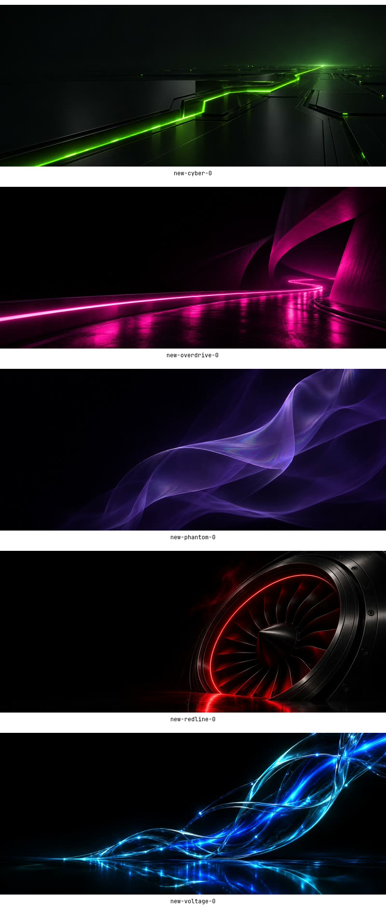

# Afterburn theme wallpapers

These are the actual desktop backgrounds in this public theme repository, not the website previews. Open a JPG or MP4 link and use GitHub's **Download raw file** control to save the original. The edition stills are 3440×1440; signature live loops are 2560×1072, 30 fps, twelve seconds, H.264, silent. Orange live loops are eight seconds.

| Edition | Wallpaper | Still | Animated wallpaper |
|---|---|---|---|
| Afterburn | Horizon | [JPG](backgrounds/1-horizon.jpg) | [MP4](backgrounds/9-horizon-live.mp4) |
| Voltage | Resonance | [JPG](backgrounds/voltage-resonance.jpg) | [MP4](backgrounds/voltage-resonance-live.mp4) |
| Cyber | Phosphor Path | [JPG](backgrounds/cyber-phosphor-path.jpg) | [MP4](backgrounds/cyber-phosphor-path-live.mp4) |
| Overdrive | Midnight Ribbon | [JPG](backgrounds/overdrive-midnight-ribbon.jpg) | [MP4](backgrounds/overdrive-midnight-ribbon-live.mp4) |
| Redline | Crimson Turbine | [JPG](backgrounds/redline-crimson-turbine.jpg) | [MP4](backgrounds/redline-crimson-turbine-live.mp4) |
| Phantom | Spectral Veil | [JPG](backgrounds/phantom-spectral-veil.jpg) | [MP4](backgrounds/phantom-spectral-veil-live.mp4) |
| Lite (light) | Contrail and Heat Shield | [Contrail JPG](.editions/lite/backgrounds/1-horizon.jpg) · [Heat Shield JPG](.editions/lite/backgrounds/8-heat-shield.jpg) | [MP4](.editions/lite/backgrounds/live-heat-shield.mp4) |

The root [`backgrounds/` folder](backgrounds/) contains all nineteen wallpapers, so the base Afterburn wallpaper picker can select any colour. Edition-specific folders retain their own curated defaults.

## All files by edition

- **Afterburn:** [all stills and MP4s](backgrounds/)
- **Voltage:** [all stills and MP4s](.editions/voltage/backgrounds/) · [cool](.editions/voltage/heat-wallpapers/cool/) · [hot](.editions/voltage/heat-wallpapers/hot/)
- **Cyber:** [all stills and MP4s](.editions/cyber/backgrounds/) · [cool](.editions/cyber/heat-wallpapers/cool/) · [hot](.editions/cyber/heat-wallpapers/hot/)
- **Overdrive:** [all stills and MP4s](.editions/overdrive/backgrounds/) · [cool](.editions/overdrive/heat-wallpapers/cool/) · [hot](.editions/overdrive/heat-wallpapers/hot/)
- **Redline:** [all stills and MP4s](.editions/redline/backgrounds/) · [cool](.editions/redline/heat-wallpapers/cool/) · [hot](.editions/redline/heat-wallpapers/hot/)
- **Phantom:** [all stills and MP4s](.editions/phantom/backgrounds/) · [cool](.editions/phantom/heat-wallpapers/cool/) · [hot](.editions/phantom/heat-wallpapers/hot/)
- **Lite:** [all stills and MP4s](.editions/lite/backgrounds/) · [cool](.editions/lite/heat-wallpapers/cool/) · [hot](.editions/lite/heat-wallpapers/hot/). Lite is the light edition, so its eight stills and one loop stay in its own folder and are not copied into the dark themes' shared `backgrounds/`.

Orange also includes [Nozzle live](backgrounds/7-nozzle-live.mp4) and [Ember live](backgrounds/8-ember-live.mp4).

## Install or update

A fresh clone includes these files. The extras installer's colour-edition step copies `.editions/<name>` into your Omarchy themes folder. The leading dot keeps the other five themes out of the orange theme's staging directory when you switch themes.

Existing installations are separate copies: pulling this repository does not replace your installed edition backgrounds, and rerunning the installer preserves existing files. Back up `backgrounds/` and `heat-wallpapers/` in an installed `afterburn-<edition>` theme, copy the matching folders from `.editions/<edition>/`, then reselect that theme. Restore your saved folders to undo. Keep each edition's files in its own theme.

[Artwork, rendering and validation details](docs/wallpapers/README.md).
