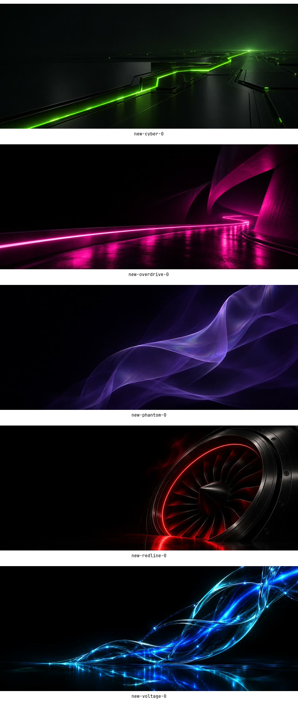

# Edition wallpaper refresh

Orange Afterburn's six stills, three live loops and film assets are unchanged.
The five other editions now have original signature art rather than recoloured
orange live loops. Their five alternative stills remain available. Full-resolution
copies of each signature still and MP4 also live directly in the root `backgrounds/`
folder, named `<edition>-<artwork>.jpg` and `<edition>-<artwork>-live.mp4`.
The base theme picker can select these colours too; its original default remains first.



| Edition | Signature | Motion |
| --- | --- | --- |
| Voltage | Resonance: blue/cyan charged-glass threads | Travelling electrical ripple, soft luminous breath |
| Cyber | Phosphor Path: acid-green engraved circuit plane | Very small optical drift and slow phosphor pulse |
| Overdrive | Midnight Ribbon: magenta highway through black architecture | Gliding reflection ripple and neon breath |
| Redline | Crimson Turbine: black titanium and a razor-red ring | Restrained heat shimmer and tight red glow |
| Phantom | Spectral Veil: translucent violet folds | Wider, slow flowing displacement and fading light |

The default still retains the filename `1-horizon.jpg` for wallpaper selection
and heat-level compatibility. Matching cool/hot versions use the same new art.
Each edition has one signature `live-*.mp4`: 12 seconds, 2560×1072, 30 fps,
H.264 High, yuv420p, no audio, fast-start metadata. Animation is rendered with
FFmpeg displacement fields and gently changing gamma that preserves black; the camera moves only
a few pixels. All motion terms are periodic over exactly 12 seconds, so the
last-to-first step continues the motion. There are no cuts, flashes or shake.
OWE controls playback, fullscreen pausing and battery policy as before.

## Sources and build

The built-in Codex image generation tool created the original PNGs in
`tools/wallpapers/sources/`. Full generation prompts are in `prompts.json`.
These are generated images, not native-resolution 3440px renders; delivery
stills are resized and cropped to 3440×1440. Loops use a small overscan crop.

```sh
python3 tools/wallpapers/render.py all
tools/make-editions.sh
python3 tools/wallpapers/verify.py
```

The first command renders assets into `tools/edition-extras/<edition>/files/`.
The edition builder copies those into `.editions/` and publishes the signature
still/loop copies to root `backgrounds/`, skips the old default
horizon and its heat variants, and keeps the orange live loops exclusive to
the base. It does not invoke image generation or need an API key. FFmpeg with
libx264 is required; edition rebuilding keeps its existing dependencies.

The older edition-specific arcgrid, glyph rain, speed streaks, tachometer,
heat-haze and ghost-aurora loops were retired after visual review. Historical
render scripts remain for provenance, but their outputs are not shipped.

## Updating an installed theme

GitHub assets and installed desktop files are separate copies. This refresh
does not activate a theme or change a running desktop. The current extras
installer preserves existing files, so rerunning it will not replace an older
installed `1-horizon.jpg` or remove retired videos. Back up an installed edition
and replace its `backgrounds/` and `heat-wallpapers/` folders with the matching
folders from this checkout to adopt the complete set, then select its theme.
Do not copy these edition folders over the orange base folders.

## Review and rollback

`verify.py` checks encoded specifications, decodes every frame, measures motion
and the loop boundary, and checks source/staged asset equality. It does not
establish real-desktop GPU performance. Native OWE playback still needs a
desktop check. Revert the wallpaper-refresh commit and rebuild editions to
restore the old repository artwork. Restore the saved installed folders to
undo a manual desktop update.
